# 📚 Baza Wiedzy UX, Dostępności Cyfrowej i Pozycjonowania (SEO)

Kompleksowa, rygorystyczna baza wiedzy i wytycznych inżynieryjno-projektowych dotyczących projektowania, optymalizacji i audytowania serwisów internetowych. Opracowana w oparciu o autorytatywne źródła badawcze, standardy międzynarodowe i wytyczne branżowe.

---

## 🗺️ Mapa Wiedzy (Knowledge Map)

Poniższy diagram przedstawia architekturę bazy wiedzy podzieloną na 8 fundamentalnych filarów UX oraz powiązany filar pozycjonowania (SEO):

```mermaid
flowchart TD
    Root["Baza Wiedzy UX & SEO"] --> UX["Obszary UX & Usability"]
    Root --> SEO["Pozycjonowanie & Wydajność"]
    Root --> Audit["Narzędzia & Wdrożenie"]

    UX --> M1["1. Nawigacja<br/><i>Czy z każdej podstrony wrócisz na główną?</i>"]
    UX --> M2["2. Struktura i układ<br/><i>Czy nagłówki tworzą hierarchię H1-H3?</i>"]
    UX --> M3["3. Treść i czytelność<br/><i>Czy rozmiar i kontrast tekstu ułatwiają czytanie?</i>"]
    UX --> M4["4. Formularze<br/><i>Czy walidacja działa w czasie rzeczywistym?</i>"]
    UX --> M5["5. Funkcjonalność<br/><i>Czy koszyk i wyszukiwarka działają bezbłędnie?</i>"]
    UX --> M6["6. Dostępność cyfrowa<br/><i>Czy po stronie da się poruszać samą klawiaturą?</i>"]
    UX --> M7["7. Estetyka & Brand<br/><i>Czy design jest zgodny z identyfikacją marki?</i>"]
    UX --> M8["8. Bezpieczeństwo<br/><i>Czy strona działa na HTTPS i chroni dane?</i>"]

    SEO --> M9["9. SEO & Core Web Vitals<br/><i>LCP, INP, CLS & Search Essentials</i>"]

    Audit --> M10["10. Zbiorcza Checklista Audytowa (90 pkt)"]
    Audit --> M11["11. Spis Źródeł i Bezpośrednich Linków"]
s
    click M1 "docs/01-nawigacja.md" "Przejdź do wytycznych nawigacji"
    click M2 "docs/02-struktura-i-uklad.md" "Przejdź do wytycznych struktury"
    click M3 "docs/03-tresc-i-czytelnosc.md" "Przejdź do wytycznych treści"
    click M4 "docs/04-formularze.md" "Przejdź do wytycznych formularzy"
    click M5 "docs/05-funkcjonalnosc-i-ecommerce.md" "Przejdź do e-commerce"
    click M6 "docs/06-dostepnosc-wcag.md" "Przejdź do dostępności WCAG 2.2"
    click M7 "docs/07-estetyka-i-brand.md" "Przejdź do estetyki i brandu"
    click M8 "docs/08-bezpieczenstwo-i-zaufanie.md" "Przejdź do bezpieczeństwa"
    click M9 "docs/09-pozycjonowanie-seo-ux.md" "Przejdź do SEO i CWV"
    click M10 "docs/10-checklista-audytowa.md" "Przejdź do checklisty"
    click M11 "docs/11-zrodla-i-linki.md" "Przejdź do bibliografii i linków"
    click M12 "TEAMS_POST.md" "Przejdź do szablonu Teams"
```

---

## 📑 Spis Treści i Przewodnik po Modułach

Każdy moduł zawiera:**Kluczowe wytyczne techniczne z precyzyjnymi wartościami**, **Sprawdzone źródła z cytowaniami**, **Tabelę antywzorców** oraz **Indywidualną checklistę weryfikacyjną**.

| Moduł | Obszar | Pytanie wiodące audytu | Kluczowe normy i standardy | Link do dokumentu |
|:---:|---|---|---|:---:|
| **01** | **Nawigacja** | *Czy z każdej podstrony wrócisz na stronę główną?* | NN/g, W3C WAI Breadcrumbs, Prawo Millera | [01-nawigacja.md](docs/01-nawigacja.md) |
| **02** | **Struktura i układ** | *Czy nagłówki tworzą hierarchię H1, H2, H3?* | F-Pattern, 8pt Grid, Semantyka HTML5, ISO 9241-210 | [02-struktura-i-uklad.md](docs/02-struktura-i-uklad.md) |
| **03** | **Treść i czytelność** | *Czy rozmiar i kontrast tekstu ułatwiają czytanie?* | WCAG 2.2 (1.4.3 AA min 4.5:1), line-height 1.5, Plain Language (ISO 24495-1) | [03-tresc-i-czytelnosc.md](docs/03-tresc-i-czytelnosc.md) |
| **04** | **Formularze** | *Czy walidacja działa w czasie rzeczywistym?* | Baymard Institute (timing blur/keystroke), top-aligned labels, autocomplete | [04-formularze.md](docs/04-formularze.md) |
| **05** | **Funkcjonalność** | *Czy koszyk i wyszukiwarka działają bezbłędnie?* | Baymard Cart Benchmark, Fuzzy Search, Guest Checkout, Faceted Navigation | [05-funkcjonalnosc-i-ecommerce.md](docs/05-funkcjonalnosc-i-ecommerce.md) |
| **06** | **Dostępność (a11y)** | *Czy po stronie da się poruszać samą klawiaturą?* | WCAG 2.2 (2.1.1, 2.4.7 focus, 2.4.11 not obscured, 2.5.8 target 24px), EAA 2025 | [06-dostepnosc-wcag.md](docs/06-dostepnosc-wcag.md) |
| **07** | **Estetyka & Brand** | *Czy design jest zgodny z identyfikacją marki?* | Design Tokens, Atomic Design, Prawo Fittsa/Hicka/Jakoba, ISO 9241-110 | [07-estetyka-i-brand.md](docs/07-estetyka-i-brand.md) |
| **08** | **Bezpieczeństwo** | *Czy strona działa na HTTPS i chroni dane?* | HTTPS/HSTS, zakaz blokowania wklejania haseł (NIST SP 800-63B), RODO, OWASP | [08-bezpieczenstwo-i-zaufanie.md](docs/08-bezpieczenstwo-i-zaufanie.md) |
| **09** | **SEO & Pozycjonowanie** | *Czy witryna spełnia kryteria Core Web Vitals i Search Essentials?* | Google Search Essentials, LCP $\le$ 2.5s, INP $\le$ 200ms (od 2024), CLS $\le$ 0.1, Schema.org | [09-pozycjonowanie-seo-ux.md](docs/09-pozycjonowanie-seo-ux.md) |
| **10** | **Checklista audytowa** | *Jak szybko i rzetelnie ocenić serwis?* | Kompletny arkusz 90 punktów kontrolnych z matrycą punktacji | [10-checklista-audytowa.md](docs/10-checklista-audytowa.md) |
| **11** | **Bibliografia i Linki** | *Gdzie sprawdzić oficjalne źródła i specyfikacje?* | Zweryfikowane odnośniki URL do W3C, NN/g, Baymard, Google, NIST, OWASP, ISO | [11-zrodla-i-linki.md](docs/11-zrodla-i-linki.md) |

---

## 🔬 Metodologia weryfikacji i źródła danych

Baza wiedzy została opracowana z wykorzystaniem dedykowanego subagenta weryfikacyjnego (`ux_source_verifier`), który odrzucił niesprawdzone opinie blogowe i zweryfikował wyłącznie **oficjalne rekomendacje badawcze oraz standardy techniczne**:

1. **W3C (World Wide Web Consortium):**
   * *Web Content Accessibility Guidelines (WCAG) 2.2* – Oficjalna rekomendacja z 5 października 2023 r.
   * *WAI-ARIA Authoring Practices Guide (APG)* – wzorce nawigacji klawiaturą i technologie asystujące.
2. **Nielsen Norman Group (NN/g):**
   * Wiodący światowy ośrodek badań użyteczności pod kierownictwem Jakoba Nielsena i Dona Normana. Ponad 25 lat badań laboratoryjnych i okulograficznych (eyetracking).
3. **Baymard Institute:**
   * Największy niezależny instytut badawczy e-commerce UX (ponad 75 000 godzin testów użyteczności, analiza ponad 130 największych sklepów, audyty procesów checkout i wyszukiwarek).
4. **Google Search Central & Web.dev:**
   * *Google Search Essentials* oraz oficjalne standardy wydajnościowe **Core Web Vitals** (z uwzględnieniem metryki INP obowiązującej od marca 2024 r.).
5. **OWASP & NIST:**
   * *OWASP Top 10 Web Application Security Risks* oraz *NIST Special Publication 800-63B (Digital Identity Guidelines)*.
6. **Międzynarodowa Organizacja Normalizacyjna (ISO):**
   * *ISO 9241-110:2020* (Zasady dialogu i interakcji człowiek-system), *ISO 9241-210:2019* (Projektowanie zorientowane na człowieka) oraz *ISO 24495-1:2023* (Plain Language).

---

## 🚀 Jak poruszać się po bazie i wdrażać wytyczne?

1. **Dla Projektantów UI/UX:**
   * Zacznij od modułów [02-struktura-i-uklad.md](docs/02-struktura-i-uklad.md), [03-tresc-i-czytelnosc.md](docs/03-tresc-i-czytelnosc.md) oraz [07-estetyka-i-brand.md](docs/07-estetyka-i-brand.md). Zwróć szczególną uwagę na siatkę 8pt, tokeny projektowe i minimalne rozmiary celów dotykowych (24x24px / 44x44px).
2. **Dla Programistów Frontend:**
   * Zapoznaj się z modułami [04-formularze.md](docs/04-formularze.md) (logika zdarzeń `blur` i `input`), [06-dostepnosc-wcag.md](docs/06-dostepnosc-wcag.md) (nawigacja klawiaturą, `:focus-visible`, `scroll-padding`) oraz [09-pozycjonowanie-seo-ux.md](docs/09-pozycjonowanie-seo-ux.md) (optymalizacja LCP, INP, CLS).
3. **Dla Audytorów i Product Ownerów:**
   * Otwórz [10-checklista-audytowa.md](docs/10-checklista-audytowa.md) i przeprowadź punktową ewaluację serwisu. Każda niezgodność odsyła do konkretnego modułu z instrukcją naprawy.

